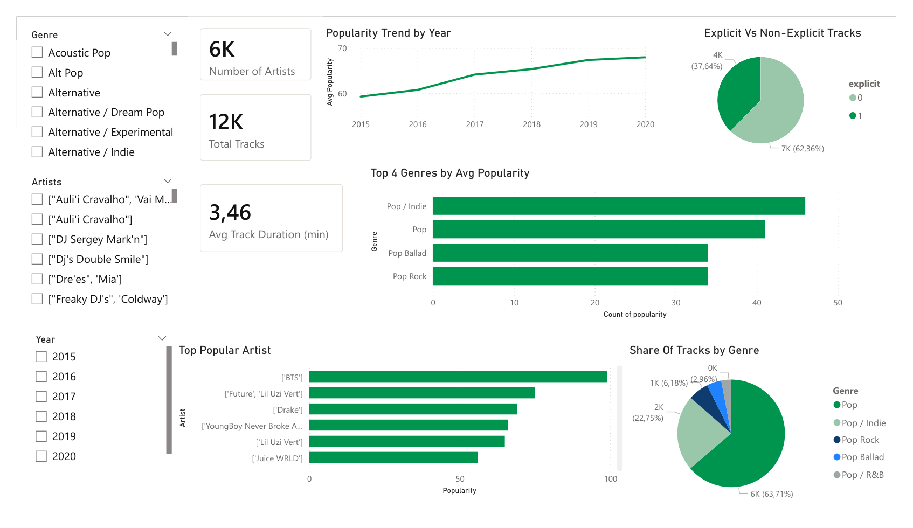
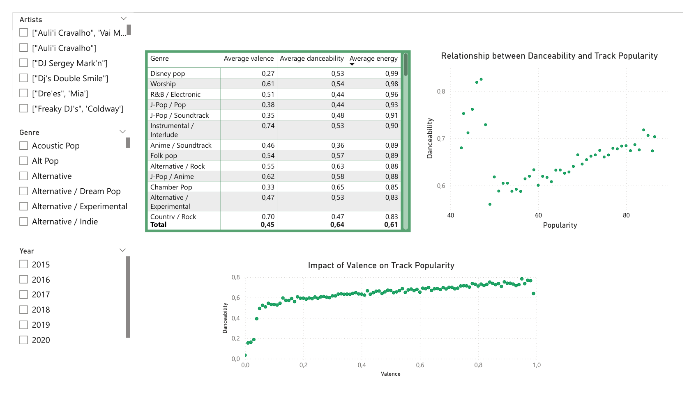
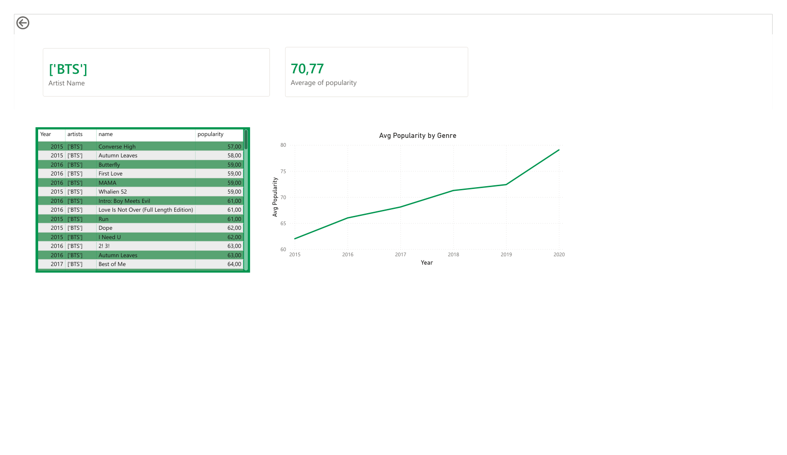

# Spotify Music Trends & Popularity Analysis

**Business Intelligence | SQL · Power BI · DAX · Excel · Python**

A collaborative university project analyzing **11,762 Spotify tracks** to explore music popularity, audio characteristics, genres, and artist performance. The project combines data preparation, dimensional modeling, and an interactive three-page Power BI report to support music-industry decision-making.

**[View Dashboard (PDF)](powerbi/dashboard_preview.pdf)** · [Download Interactive Dashboard (.pbix)](powerbi/Spotify_BIFV.pbix) · [Download Power BI Template (.pbit)](powerbi/Spotify_BIFV.pbit) · [Read Final Project Report (PDF)](docs/final_report.pdf)

## Project overview

- **Objective:** Explore how music popularity varies across genres, artists, release periods, and audio features.
- **Dataset:** 11,762 analyzed tracks (from a larger source dataset).
- **Data preparation:** Excel cleaning and an ETL notebook.
- **Data model:** Star schema with one fact table (`FactTracks`) and four dimensions (`DimGenre`, `DimArtist`, `DimTrack`, `DimDate`).
- **Reporting:** Three-page Power BI dashboard with DAX measures, trend analysis, and artist drill-through.
- **Collaboration:** Team project; team members worked together across project stages.

## Dashboard pages

1. **Executive summary** — overview of music popularity and key performance indicators.
2. **Audio feature analysis** — relationships between popularity and characteristics such as danceability and energy.
3. **Artist drill-through** — artist-level exploration and comparisons.

## Dashboard screenshots

The following screenshots provide a quick preview of the three-page Power BI dashboard. For the complete report, see the [dashboard PDF](powerbi/dashboard_preview.pdf).

### 1. Executive summary

### 2. Audio feature analysis

### 3. Artist drill-through

## Selected findings

- The dataset showed increasing popularity trends across releases from 2015–2020.
- Pop genres represented a substantial share of the analyzed tracks.
- Danceability and energy were positively **associated** with popularity in the analysis; these are not causal findings.
- Findings informed recommendations for playlist curation and artist promotion.

## Repository contents

| Path | Purpose |
| --- | --- |
| [`notebooks/`](notebooks/) | [Portable data validation notebook](notebooks/etl_preprocessing.ipynb) and [original coursework ETL](notebooks/original_etl_coursework.ipynb) |
| [`data/`](data/) | [Cleaned Spotify dataset](data/spotify_cleaned.csv) and [data dictionary](data/Data_dictionary.pdf) |
| [`powerbi/`](powerbi/) | [Power BI report](powerbi/Spotify_BIFV.pbix), [template](powerbi/Spotify_BIFV.pbit), and [dashboard preview](powerbi/dashboard_preview.pdf) |
| [`docs/`](docs/) | [Final report](docs/final_report.pdf), [data model diagram](docs/data_model_diagram.pdf), [DAX measures](docs/dax_measures.pdf), [use case](docs/use_case.pdf), and [presentation](docs/presentation.pdf) |

**Status:** Portfolio files available: dashboard, ETL notebook, cleaned dataset, data dictionary, and supporting documentation.

## Technical methodology

### 1. Data preparation and quality checks

The [original coursework ETL notebook](notebooks/original_etl_coursework.ipynb) documents a Python/pandas workflow that:

- Inspects missing values, data types, and duplicate rows.
- Converts `release_date` to a datetime field with invalid values coerced to missing.
- Converts track duration from milliseconds (`duration_ms`) to minutes (`duration_min`) and drops the original duration column.
- Uses the interquartile range (IQR) rule to cap values outside 1.5 × IQR for numeric columns.
- Exports intermediate and processed CSV files.

The [portfolio dataset](data/spotify_cleaned.csv) and [data dictionary](data/Data_dictionary.pdf) are provided for inspection. The original notebook is preserved for reference. A [portable validation notebook](notebooks/etl_preprocessing.ipynb) reads the published cleaned CSV without reapplying transformations; optional raw-data preprocessing requires the original source dataset.

### 2. Data modeling

The BI model uses a star-schema design, with `FactTracks` and four dimension tables: `DimGenre`, `DimArtist`, `DimTrack`, and `DimDate`. See the [data model diagram](docs/data_model_diagram.pdf) for the project design.

### 3. Measures and reporting

Power BI and DAX were used to create the three dashboard pages, including high-level indicators, audio-feature analysis, and artist drill-through. See the [DAX measure definitions](docs/dax_measures.pdf) and [final project report](docs/final_report.pdf) for further details.

## How to explore the project

**Quickest option:** Open the [dashboard preview (PDF)](powerbi/dashboard_preview.pdf) or view the screenshots above.

**Interactive dashboard:** Download [`Spotify_BIFV.pbix`](powerbi/Spotify_BIFV.pbix) and open it in Microsoft Power BI Desktop. If prompted to refresh data, you may need to point the report's data source to the included [CSV](data/spotify_cleaned.csv); the saved report's source configuration has not been independently verified.

**Template:** Download [`Spotify_BIFV.pbit`](powerbi/Spotify_BIFV.pbit) to inspect the reusable report template. Loading the template may require configuring its data source.

**Python notebook:** Open [`notebooks/etl_preprocessing.ipynb`](notebooks/etl_preprocessing.ipynb) in Jupyter and run the cells from the repository root or `notebooks/` directory. Install `pandas` and `numpy` first (`pip install pandas numpy`). By default it validates the included cleaned CSV without altering it. To process raw input instead, supply the original raw dataset containing `duration_ms` and set `raw_path` in the first code cell. The [original coursework notebook](notebooks/original_etl_coursework.ipynb) is preserved unchanged. The new notebook has not yet been execution-tested against the repository CSV, and raw preprocessing is not confirmed to reproduce the published dashboard dataset exactly.

## Tools and techniques

**SQL**, dimensional modeling/star schema, **Power BI**, **DAX**, **Excel**, data cleaning, exploratory analysis, and data visualization.

## Limitations

The findings describe patterns in the analyzed Spotify dataset; correlations between audio features and popularity do not establish causation.
